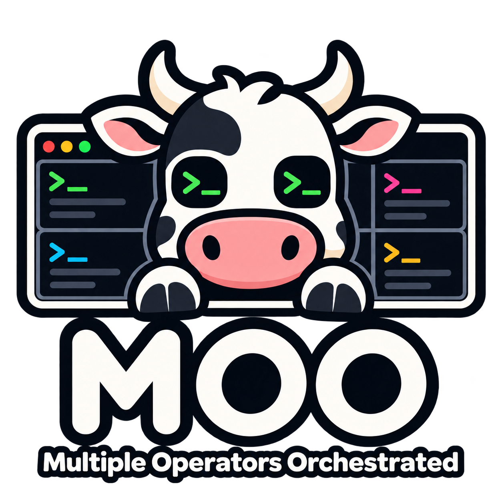

# Moo — Multiple Operators Orchestrated

<p align="center">
  
</p>

A fork of [Herdr](https://github.com/herdrdev/herdr), the terminal runtime for coding agents. It keeps Herdr's detachable server, panes, and agent status, and adds agent-focused features. It installs and runs beside upstream Herdr without sharing state.

> **Status:** experimental. The full Rust test suite passes on the fork; the interactive UI has been checked in a terminal only for the features listed below.

## what's different

- **separate identity** — the binary is `moo`. Config, state, logs, and sockets live under `moo` paths, so it never touches an upstream install. Debug builds use `moo-dev`.
- **agent-aware command palette** — open it with `prefix+space` (default prefix `ctrl+b`) and search actions by name.
- **agent names in the sidebar** — rename an agent from the sidebar or with `moo agent rename <target> <name>`; `--clear` resets it.
- **attention queue** — agents that need an answer are queued, and you can acknowledge them.
- **durable status history** — agent status changes are recorded and exposed through the API as `agent.history`.
- **tab colors** — right-click a tab and choose **Color** to give it a theme color. Its tab dot and the bar beside its agents in the sidebar use that color.
- **fork-only remotes** — remote attach and saved SSH machines look for `moo` on the remote host and never fetch upstream `herdr`. Automated Windows install is refused for now.

Everything else follows upstream Herdr, with `moo` in place of `herdr`.

## install

Requires a Rust toolchain and Zig 0.16.0 (for the vendored libghostty-vt).

```bash
git clone https://github.com/allisonhere/moo
cd herdr
./scripts/install-moo.sh
```

This builds the locked release binary and installs it to `~/.local/bin`; set `MOO_INSTALL_DIR` to change that. Then run:

```bash
moo
```

`ctrl+b q` detaches and `moo` reattaches. `moo update` does not download anything; rerun the install script to update.

## docs

The fork guide is [`docs/next/website/src/content/docs/moo.mdx`](docs/next/website/src/content/docs/moo.mdx): requirements, identity paths, troubleshooting, removal, and current limitations. Upstream docs at [herdr.dev/docs](https://herdr.dev/docs/) apply to everything the fork has not changed.

## development

```bash
cargo build --release --locked --bin moo
just test        # unit tests
just check       # formatting, tests, and maintenance checks
```

Read [`AGENTS.md`](./AGENTS.md) and [`CLAUDE.md`](./CLAUDE.md) before making changes.

## license

Apache License 2.0, the same as upstream Herdr. See [LICENSE](LICENSE). Herdr is by [herdrdev](https://github.com/herdrdev/herdr).
